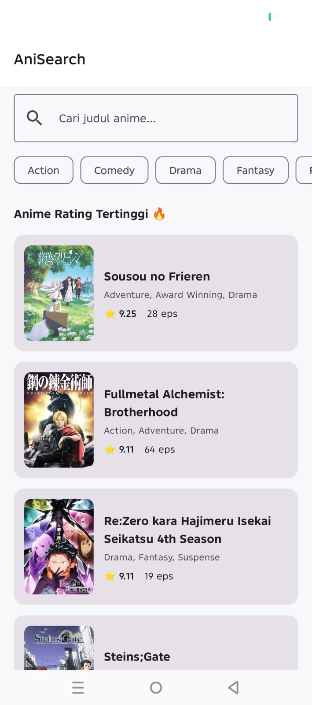
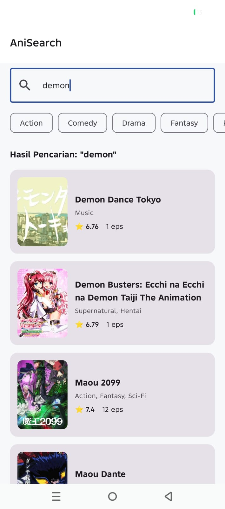
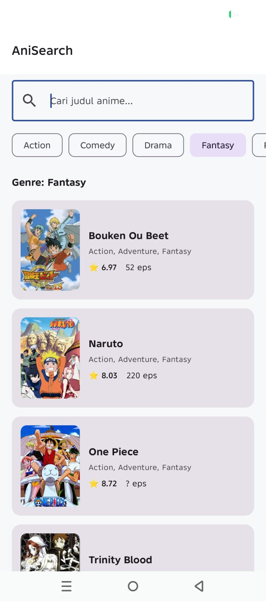
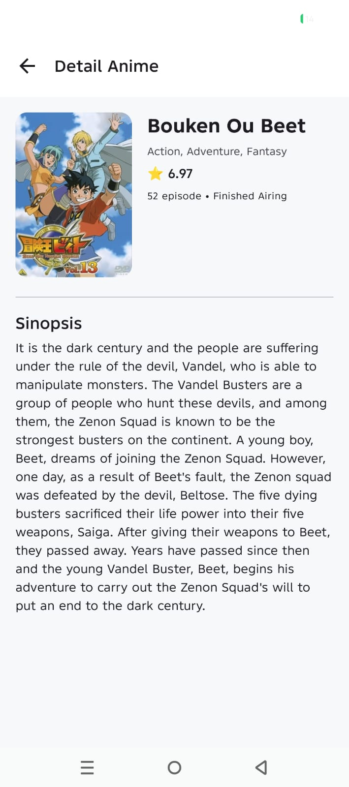

# OtakuDesu (AniSearch)

**OtakuDesu** adalah aplikasi katalog dan pencarian informasi anime modern berbasis Android yang dibangun menggunakan bahasa pemrograman **Kotlin** dan **Jetpack Compose**. Aplikasi ini memungkinkan pengguna untuk menemukan anime terpopuler dengan rating tertinggi, melakukan pencarian berdasarkan kata kunci, memfilter anime berdasarkan genre, serta melihat informasi detail anime secara lengkap.

---

## Deskripsi Singkat Aplikasi

OtakuDesu dirancang untuk memberikan pengalaman menjelajah informasi anime yang cepat, responsif, dan intuitif. Aplikasi ini secara otomatis menampilkan daftar anime dengan rating tertinggi ketika pertama kali dijalankan.

### Fitur Utama:
* **Feed Top Rated Anime**: Menampilkan daftar anime dengan rating tertinggi secara otomatis saat aplikasi dibuka.
* **Pencarian Real-Time**: Pencarian judul anime berdasarkan kata kunci dengan input yang responsif.
* **Filter Genre**: Penyaringan anime cepat menggunakan *Filter Chips* (Action, Comedy, Drama, Fantasy, Romance, Sci-Fi).
* **Tampilan Detail Lengkap**: Menyajikan informasi detail mencakup poster gambar resolusi tinggi, skor rating (⭐), jumlah episode, status penayangan, genre, dan sinopsis lengkap.
* **Penanganan Koneksi Network & Error Handling**: Penanganan kesalahan jaringan yang informatif dilengkapi dengan tombol *Coba Lagi (Retry)*.

---

## Screenshoot Aplikasi

### Screenshoot Fitur Utama:
* **Home Screen**:  
  

* **Fitur Search**:  
  

* **Fitur Filter**:  
  

* **Tampilan Detail Lengkap**:  
  

---

## Penjelasan Struktur MVVM

Aplikasi OtakuDesu menerapkan arsitektur **MVVM (Model-View-ViewModel)** dipadukan dengan **Repository Pattern** untuk memisahkan logika bisnis, pengelolaan data, dan antarmuka pengguna (UI) secara bersih (*separation of concerns*).

```
 ┌─────────────────────────────────────────────────────────┐
 │                       VIEW (UI)                         │
 │  (HomeScreen, DetailScreen, AnimeItemCard, Compose UI)  │
 └───────────────────────────▲─────────────────────────────┘
                             │ Observes StateFlow
 ┌───────────────────────────┴─────────────────────────────┐
 │                       VIEWMODEL                         │
 │      (HomeViewModel, DetailViewModel, UiState)          │
 └───────────────────────────▲─────────────────────────────┘
                             │ Calls suspend functions
 ┌───────────────────────────┴─────────────────────────────┐
 │                       REPOSITORY                        │
 │                   (AnimeRepository)                     │
 └───────────────────────────▲─────────────────────────────┘
                             │ Fetch Data
 ┌───────────────────────────┴─────────────────────────────┐
 │                      MODEL / DATA                       │
 │  (JikanApiService, JikanApi, Anime Data Models, Gson)   │
 └─────────────────────────────────────────────────────────┘
```

### 1. Model (Layer Data)
* **Data Models (`Anime.kt`)**: Merepresentasikan struktur data anime yang diterima dari API (`Anime`, `Genre`, `AnimeImages`, `ImageUrls`). Menggunakan annotation `@SerializedName` dari Gson dan getter kustom untuk menjamin *null-safety*.
* **Remote Source (`JikanApiService.kt` & `JikanApi.kt`)**: Mendefinisikan antarmuka panggilan HTTP Retrofit dan mengonfigurasi OkHttp Client dengan *timeout* 30 detik serta *header interceptor*.
* **Repository (`AnimeRepository.kt`)**: Menjadi *single source of truth* yang mengabstraksi pemanggilan API remote untuk digunakan oleh ViewModel.

### 2. ViewModel (Layer Logika Bisnis & State)
* **`HomeViewModel.kt` & `DetailViewModel.kt`**: Mengelola *UI State* aplikasi menggunakan `StateFlow` dan Kotlin Coroutines (`viewModelScope`).
* **UI State (`HomeUiState` & `DetailUiState`)**: Menggunakan *sealed interface* untuk merepresentasikan status tampilan secara deklaratif (`Loading`, `Success`, `Error`, `Idle`).

### 3. View (Layer Antarmuka Pengguna)
* **Jetpack Compose UI (`HomeScreen.kt`, `DetailScreen.kt`, `AnimeItemCard.kt`)**: Mengamati perubahan state dari ViewModel secara reaktif (`collectAsState()`) dan mengonversi state tersebut menjadi tampilan antarmuka berbasis Material Design 3.
* **Coil Integration (`AsyncImage`)**: Memuat dan menampilkan gambar poster anime dari URL secara *asynchronous*.

---

## Penjelasan Penggunaan API

OtakuDesu menggunakan layanan REST API terbuka **Tenrai API v4** (sebuah *fast mirror* terpercaya dari database MyAnimeList / Jikan API v4) dengan format pertukaran data JSON.

* **Base URL**: `https://api.tenrai.org/v1/`

### Konfigurasi Retrofit & OkHttp (`JikanApi.kt`):
Panggilan API dikonfigurasi menggunakan **Retrofit 2** dan **OkHttp 4** dengan fitur-fitur berikut:
1. **User-Agent Interceptor**: Menyisipkan header `"User-Agent": "OtakuDesu/1.0 (Android)"` dan `"Accept": "application/json"` pada setiap request untuk mencegah pemblokiran/throttling oleh server.
2. **HttpLoggingInterceptor**: Mencatat log aktivitas request dan response HTTP pada Logcat untuk keperluan debugging.
3. **Timeout Control**: Mengatur durasi *Connect*, *Read*, dan *Write timeout* sebesar 30 detik untuk memastikan kestabilan koneksi pada jaringan seluler.

### Endpoint API yang Digunakan:

| Method | Endpoint | Fungsi | Parameter |
| :--- | :--- | :--- | :--- |
| `GET` | `/top/anime` | Mengambil daftar anime dengan rating tertinggi (*Top Rated*) | - |
| `GET` | `/anime` | Mencari anime berdasarkan kata kunci judul dan/atau genre | `q` (Query String), `genres` (Genre ID) |
| `GET` | `/anime/{id}` | Mengambil informasi detail lengkap satu anime berdasarkan ID | `id` (Anime MAL ID) |

---

## 🛠️ Pustaka & Teknologi yang Digunakan

* **Language**: [Kotlin](https://kotlinlang.org/)
* **UI Framework**: [Jetpack Compose](https://developer.android.com/jetpack/compose) dengan [Material Design 3](https://m3.material.io/)
* **Navigation**: [Navigation Compose](https://developer.android.com/jetpack/compose/navigation)
* **Networking**: [Retrofit 2](https://square.github.io/retrofit/) & [OkHttp 4](https://square.github.io/okhttp/)
* **JSON Parser**: [Gson Converter](https://github.com/google/gson)
* **Image Loading**: [Coil Compose](https://coil-kt.github.io/coil/compose/)
* **Concurrency**: [Kotlin Coroutines](https://kotlinlang.org/docs/coroutines-overview.html) & [StateFlow](https://kotlinlang.org/api/kotlinx.coroutines/kotlinx-coroutines-core/kotlinx.coroutines.flow/-state-flow/)
